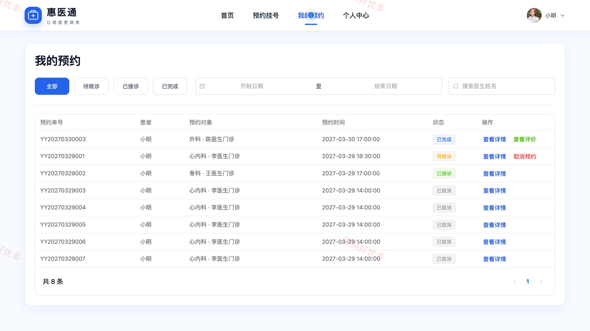
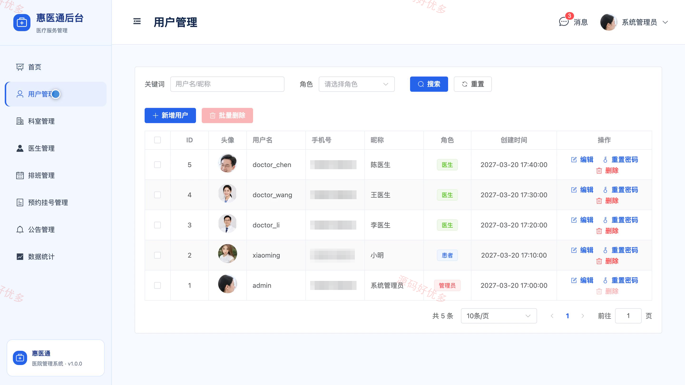
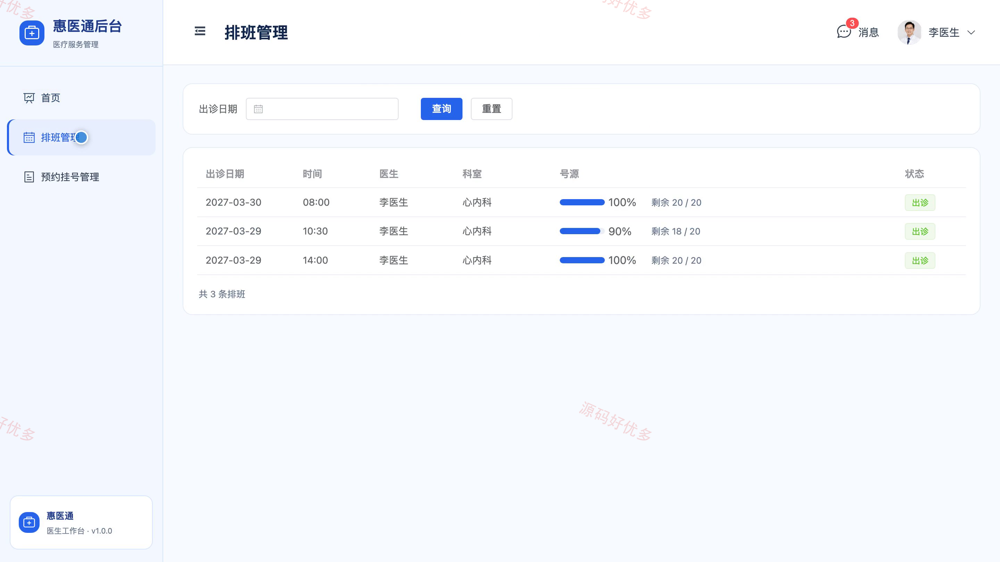
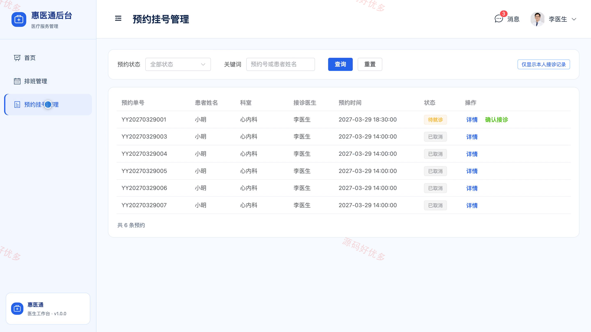

# bs007C
bs007C基于Django的医院管理系统源码 Python Django Vue3 设计文档 PPT
## 源码问题查看主页咨询

### 一、关键词
医院管理系统、门诊预约、在线挂号、智慧医疗、诊疗服务

### 二、作品包含
源码+数据库+万字设计文档+PPT+全套环境和工具资源+本地部署教程

### 三、项目技术
前端技术： Html、Css、Js、Vue3.4、Element-Plus
后端技术：Python、Django

### 四、运行环境要求
开发工具：PyCharm + VSCODE

数据库：MySQL5.7+（共9张表）

数据库管理工具：Navicat10以上版本

环境配置软件： Python3+

前端Nodejs：16+

浏览器：谷歌浏览器

### 五、项目介绍
项目编号：bs007C

本系统面向医院门诊预约与诊疗协同场景，为患者提供科室医生查询、在线预约、预约进度查看和就诊评价，为医生提供本人排班、预约接诊与病历记录，为管理员提供用户、科室、医生、排班、公告及统计管理。

角色：患者、医生、管理员

患者功能：科室与医生查询、预约挂号、我的预约查看、预约取消、就诊评价、健康公告查看、个人资料维护、密码修改。

医生功能：工作台统计、个人排班查看、预约记录查看、确认接诊、病历记录填写、完成接诊、个人资料维护。

管理员功能：数据看板、用户管理、科室管理、医生管理、排班管理、预约挂号管理、公告管理、数据统计。

### 六、运行截图

